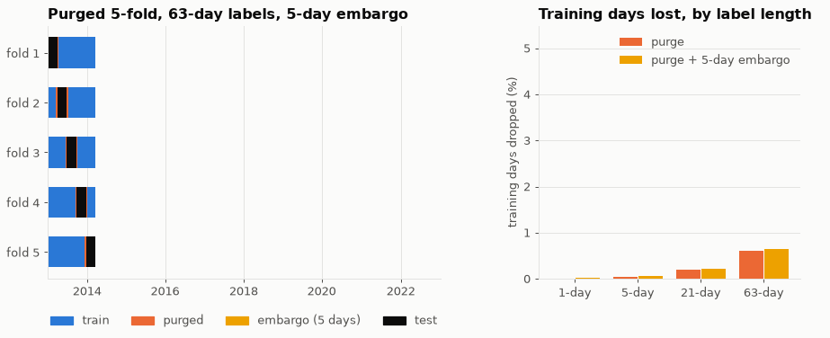
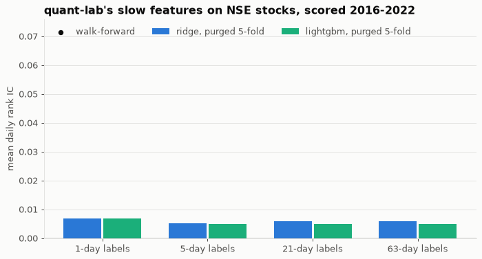
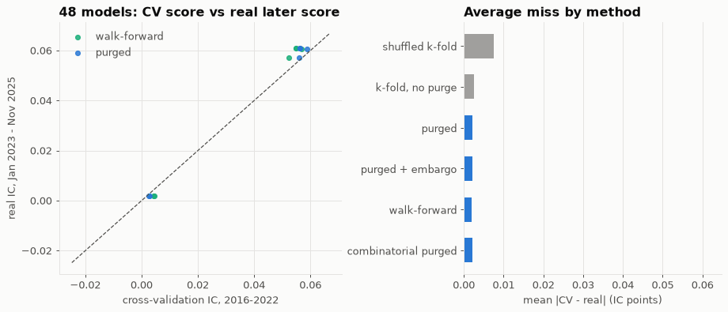
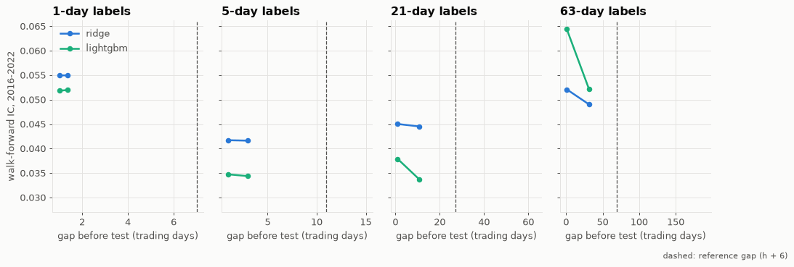
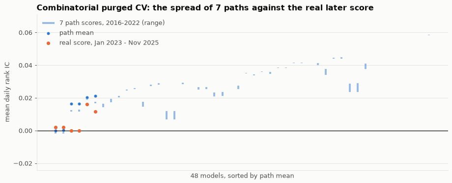

# Purged Cross-Validation

[](https://github.com/Dhirajdas18/purged-cv/actions/workflows/ci.yml)
[](https://dhirajdas18.github.io/purged-cv/)

Cross-validation for stock-return models whose labels look days ahead, where ordinary k-fold trains on
days that overlap the test period. Splitters that purge those days, the leak measured on data with a known
answer, and the purge a quant-style model on NSE stocks needs (local bhavcopy archive, 2013 – Nov 2025;
only derived results are committed).

**Live split lab: [dhirajdas18.github.io/purged-cv](https://dhirajdas18.github.io/purged-cv/)**, pick a
method, a label length and an embargo, and see which trading days each split trains on.

## Features

- [x] Splitters: purged k-fold, embargo, walk-forward with a purge, combinatorial purged CV with backtest paths
- [x] The leak on synthetic stock panels with a known true edge, including harder cases
- [x] A quant-style model on NSE stocks: features and labels rebuilt and checked against the original
- [x] Which cross-validation score predicts the score a model really gets later
- [x] How big the purge and embargo need to be, by label length
- [x] Combinatorial purged CV: a spread of out-of-sample results instead of one number
- [x] One check on Jan 2023 – Nov 2025, after every rule is fixed on earlier data

## Findings

### 1. Purging costs at most 5% of the training days, even with 63-day labels

<a href="docs/img/splits.png"><picture><source media="(prefers-reduced-motion: reduce)" srcset="docs/img/splits.png"></picture></a>

Each row is one stock on one trading day; its label is the return from the next day's open to the close
h trading days later, as in the reference model (h = 1, 5, 21, 63). Purged k-fold cuts the days into blocks; a
training day is dropped when its label window overlaps the test days' label windows, and an embargo drops
a few more days after them. Measured on the lake's trading calendar, Jan 2013 – Dec 2022 (2,468 days, the
data every rule here is chosen on), with 5 folds.

- **With 1-day labels nothing needs purging.** A 1-day label ends before the next test label starts, so
  purging drops 0.0% of the training days; a 5-day embargo drops 0.2%.
- **The cost grows with the label length, and stays small.** 5-day labels: 0.3% purged (0.5% with the
  embargo); 21-day: 1.6% (1.8%); 63-day: 5.0% (5.2%).
- **Walk-forward loses a little more to a wider gap.** Training only on the past, an exact purge leaves
  1,231 days on average for 5-day labels; the reference model's cut (train before day first test − (h + 5)) leaves
  1,225, the same as a purge plus a 6-day embargo.
- **Cheap is not the same as needed.** Whether those few days change the score is the next finding.

### 2. Shuffled k-fold found an edge of 0.28 where there was none; splitting by day removed it

<a href="docs/img/leak.png"><picture><source media="(prefers-reduced-motion: reduce)" srcset="docs/img/leak.png"></picture></a>

Synthetic stock panels, 50 stocks × 1,000 days, with five slow features (each day 98% of yesterday's
value plus noise, like a momentum signal). Feature 1 predicts the next day's return with a daily rank
correlation set by hand (0, or 0.03, a realistic size); the others are noise; shocks have fat tails. The
label is the return over the next 5 or 21 days, minus that day's average across stocks. Each method's
cross-validation score (mean daily rank IC of out-of-fold predictions) is compared with the score the
same model really gets on a fresh panel from the same process, 10 panels per case, paired. Ridge and
gradient-boosted trees; note the two charts' different scales.

- **Shuffling rows is the leak.** With no true edge, boosted trees scored an IC of +0.161 (5-day labels)
  and +0.277 (21-day) under shuffled k-fold, against a true score of about 0. Ridge, which can't
  memorise, was off by much less (+0.016 and +0.037).
- **Splitting by day did almost all the work.** Plain k-fold over blocks of days, with no purge, was off
  by +0.012 (5-day) and +0.009 (21-day) for the trees. Purging closed the 21-day gap to +0.001 and left
  the 5-day gap at +0.011.
- **The embargo changed nothing in these cases.** Purged with and without a 21-day embargo differed by
  0.003 or less everywhere, including a case with momentum in returns, which moved no result by more
  than 0.002.
- **Walk-forward is the most cautious.** With a small true edge and 21-day labels it scored 0.016
  (trees) and 0.018 (ridge) below the truth, training on half the data on average; combinatorial purged
  CV was 0.010–0.011 below.
- **When the edge flips sign halfway, every method misjudges it.** For ridge, purged k-fold scored
  −0.049 below a true score near 0 and combinatorial purged −0.033; walk-forward came closest at −0.017.

### 3. The reference model's features rebuilt exactly; walk-forward scores them lower than purged k-fold

<a href="docs/img/features.png"><picture><source media="(prefers-reduced-motion: reduce)" srcset="docs/img/features.png"></picture></a>

The reference model's ten slow stock features (momentum over 1, 6 and 12 months, distance from the 50- and 200-day
averages, 20- and 252-day volatility, 60-day beta and idiosyncratic volatility against NIFTY, 63-day
turnover) and its labels were rebuilt from the archive with the same formulas: universe rows only, each
feature clipped at the 1st and 99th percentile and ranked across stocks each day. Then Ridge and LightGBM
(the reference settings, on these features only; the reference LightGBM also sees market-wide features) were
scored on the rule-picking data, Jan 2016 – Dec 2022, as mean daily rank IC, by purged 5-fold and by
the reference model's walk-forward (retrained every 6 months, training ending h + 6 days before each block).

- **The rebuild matches the original row for row.** All 570,800 shared rows up to Aug 2025 and all 18
  feature and label columns agree, largest gap 0.0, no mismatch in missing values.
- **The features carry a steady signal.** Ridge: IC +0.056 (1-day labels), +0.043 (5-day), +0.048
  (21-day), +0.048 (63-day) under purged 5-fold.
- **Walk-forward scored lower in 7 of 8 cases,** most for LightGBM on 21-day labels (+0.028 against
  +0.041). Walk-forward trains only on the past, so on these days its models saw less data.
- **Ridge matched or beat LightGBM at every label length,** by 0.000 to 0.007 under purged 5-fold.
- **Which score to believe is still open.** The synthetic panels (finding 2) had walk-forward slightly
  below the truth; the next finding checks both against what the models really scored later.

### 4. Every honest method overstated the next three years; walk-forward missed least, purging picked best

<a href="docs/img/check.png"><picture><source media="(prefers-reduced-motion: reduce)" srcset="docs/img/check.png"></picture></a>

48 model variants were fixed in advance (`plan-topic4`, committed before any later data was scored): label
length 1, 5, 21 or 63 days × all ten features, the five trend features or the five risk features × ridge
(alpha 1 or 100) or LightGBM (7 or 31 leaves). Each method scored every variant on data up to Dec 2022
(days from 2016, the same for all). Then each variant, trained on every row whose label ended by Dec 2022,
was scored once on Jan 2023 – Nov 2025; those real scores are saved in `runs/check.json` and never
recomputed. Comparisons between methods are paired over the 48 variants, which share label lengths and
data, so the t values are rough.

- **The next three years were weaker than any honest method expected.** The 48 models made a real IC of
  +0.020 on average; purged 5-fold had scored them at +0.037, walk-forward +0.034, combinatorial purged
  +0.036. Every honest method overstated the future by 0.014–0.017.
- **Shuffled k-fold was useless.** It scored the models at +0.081 on average, missed by 0.062, and ranked
  them the wrong way round (rank correlation with the real scores −0.15).
- **On real data the purge mattered, and so did the embargo.** Plain 5-fold over day blocks missed by
  0.0202, purged 5-fold by 0.0185 (t +4.57 for the difference), purged with an h-day embargo by 0.0180
  (t −2.37 against purged alone).
- **Walk-forward missed least (0.0161, t −3.95 against purged), but purged k-fold picked better.** Taking
  each method's favourite model per label length, purged 5-fold (with or without the embargo) chose models
  that really made +0.0313, against +0.0275 for walk-forward and +0.0270 for combinatorial purged; the best
  possible was +0.0333. Purged 5-fold also ranked the models most like reality (0.64; 0.66 with the
  embargo).

### 5. The reference model's gap is enough: training up to the test added up to 0.025 IC, wider gaps added nothing

<a href="docs/img/sizing.png"><picture><source media="(prefers-reduced-motion: reduce)" srcset="docs/img/sizing.png"></picture></a>

On data to Dec 2022 only (the 2023 – 2025 results of finding 4 were not used), ridge and LightGBM on all ten
features were scored by the reference model's walk-forward with the gap before each test block set to 0, h,
h + 6 (the reference model's), 2h and 3h days, and by purged 5-fold with purges of 0, h/2 and h days and embargoes
of 0, 6, h and 2h. The decision rule was written down before the run (`plan-topic5`): the needed size is
the smallest setting whose daily IC is not detectably above the widest setting's (paired t below 2, with
the reference model's √(days / h) correction for overlapping labels).

- **Training right up to the test inflated the score, most for long labels and trees.** Walk-forward IC
  with no gap minus IC with a gap of h: LightGBM +0.0250 (63-day labels), +0.0098 (21-day), +0.0025
  (5-day), +0.0013 (1-day); ridge +0.0066, +0.0013, +0.0003, +0.0001.
- **Beyond a gap of h, nothing changed.** From h up to 3h, walk-forward IC stayed between +0.0399 and
  +0.0420 for 63-day LightGBM and between +0.0282 and +0.0307 for 21-day LightGBM.
- **The reference model's h + 6 sits on that flat part,** so it removes the overlap and costs at most 6 extra days.
  It is enough; an exact gap of h would do as well.
- **The fixed rule could not prove any of it.** No gap was detectably above the widest one (largest t
  1.6 for 63-day LightGBM), so by the rule a gap of 0 was "enough" for every walk-forward case. Eight
  years of noisy daily IC cannot confirm a leak of this size; the 48-model check in finding 4, which
  compared methods across many models, could (purge t +4.57).
- **The k-fold reference was a poor choice.** A 2h embargo throws away so much training data (126 days on
  each side for 63-day labels) that it scored lowest for that reason alone (ridge +0.0355 against
  +0.0480 with the purge only), so k-fold sizes from this rule mean little.

### 6. Seven paths agreed with each other, not with the next three years

<a href="docs/img/paths.png"><picture><source media="(prefers-reduced-motion: reduce)" srcset="docs/img/paths.png"></picture></a>

Combinatorial purged CV on data to Dec 2022: the days are cut into 8 groups, every choice of 2 is a test
set (28 splits, purged and embargoed by h days), and the test pieces join into 7 complete backtest
paths, each scored on 2016 – 2022. The 48 models of finding 4, checked against the real Jan 2023 – Nov
2025 scores saved there (a second look at that window; nothing here was tuned on it). The measures were
written down before the run (`plan-topic6`). For each label length, the best model's forecast takes a
haircut for picking the best of 12: the expected best of 12 normal draws × the path standard error ×
√(1 − the models' average path correlation).

- **The paths barely disagree.** The median standard deviation across a model's 7 paths was 0.0022 IC;
  they score the same days with heavily shared training data.
- **So their spread is no forecast range.** The real score fell inside the model's path range for 3 of
  48 models, and inside path mean ± 2 standard deviations for 3; on average the real score was 0.0163
  below the path mean.
- **But a wider spread did warn of a bigger miss.** Across the 48 models, path standard deviation and
  the size of the miss had a rank correlation of 0.77.
- **The haircut for picking was too small to matter.** It ranged from 0.0002 (1-day labels) to 0.0032
  (63-day). Over the four picks, the average miss was 0.0238 without it, 0.0228 with it and 0.0213 for
  walk-forward.
- **The long-label picks collapsed.** The best 21-day model (ridge, all features) made +0.0085 for real
  against a forecast of +0.0463; the best 63-day model (LightGBM, 7 leaves) made +0.0054 against
  +0.0471. The 1-day pick held up (+0.0605 against +0.0587).

## Quick start

```bash
uv sync
PCV_LAKE_DIR=/path/to/lake uv run pcv report splits   # topics: splits, leak, features, check, sizing, paths
uv run python scripts/build_site.py                    # site/index.html from docs/data
uv run pytest
```

The findings need a local NSE bhavcopy archive with `panel.parquet` (`PCV_LAKE_DIR`); it is not committed,
and nothing after 26 Nov 2025 is read from it. `pcv report features` also needs the original
implementation's `features.parquet` for the match check (`PCV_REF_FEATURES`), kept locally. Tests run on hand-made cases.

## Design

- `src/pcv/split.py`: `PurgedKFold`, `WalkForward`, `CombinatorialPurged` (with `paths()`), scikit-learn
  style: `split(X, y, groups=day)` with each row's trading-day number.
- `src/pcv/data.py`: the lake reader, filtered at read time to 26 Nov 2025; the trading calendar.
- `src/pcv/features.py`: the reference model's slow features and labels rebuilt from the lake.
- `src/pcv/synth.py`, `evaluate.py`: synthetic panels with a known edge; daily rank IC and out-of-fold scoring.
- `src/pcv/reports.py`, `plots.py`, `site.py`: report numbers and charts, chart style, the lab page.
- Conventions: a row's label covers days day+1 to day+h; rules are chosen on data up to Dec 2022 and
  checked once on Jan 2023 – Nov 2025; the last 365 days (from 27 Nov 2025) are never read, kept as a sealed holdout.
- Data: NSE daily bhavcopy archive, local only.
- Charts: every chart is a PNG plus an animated GIF made by `pcv report`.

Research only, not investment advice. MIT licence.
