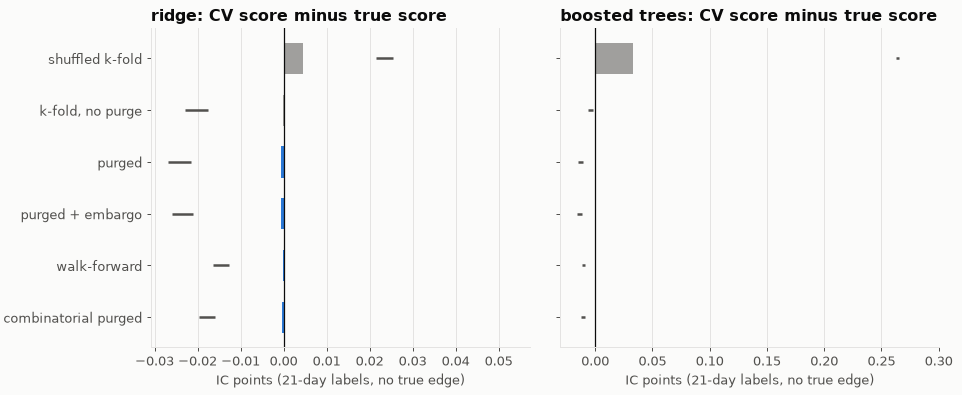

# Purged Cross-Validation

[](https://github.com/Dhirajdas18/purged-cv/actions/workflows/ci.yml)
[](https://dhirajdas18.github.io/purged-cv/)

Cross-validation for stock-return models whose labels look days ahead, where ordinary k-fold trains on
days that overlap the test period. Splitters that purge those days, the leak measured on data with a known
answer, and the purge a quant-style model on NSE stocks needs (local bhavcopy archive, 2013 – Nov 2025;
only derived results are committed).

**Live split lab: [dhirajdas18.github.io/purged-cv](https://dhirajdas18.github.io/purged-cv/)**, pick a
method, a label length and an embargo, and see which trading days each split trains on.

## Features

- [x] Splitters: purged k-fold, embargo, walk-forward with a purge, combinatorial purged CV with backtest paths
- [x] The leak on synthetic stock panels with a known true edge, including harder cases
- [x] A quant-style model on NSE stocks: features and labels rebuilt and checked against the original
- [ ] Which cross-validation score predicts the score a model really gets later
- [ ] How big the purge and embargo need to be, by label length
- [ ] Combinatorial purged CV: a spread of out-of-sample results instead of one number
- [ ] One check on Jan 2023 – Nov 2025, after every rule is fixed on earlier data

## Findings

### 1. Purging costs at most 5% of the training days, even with 63-day labels

<a href="docs/img/splits.png"><picture><source media="(prefers-reduced-motion: reduce)" srcset="docs/img/splits.png"></picture></a>

Each row is one stock on one trading day; its label is the return from the next day's open to the close
h trading days later, as in the reference model (h = 1, 5, 21, 63). Purged k-fold cuts the days into blocks; a
training day is dropped when its label window overlaps the test days' label windows, and an embargo drops
a few more days after them. Measured on the lake's trading calendar, Jan 2013 – Dec 2022 (2,468 days, the
data every rule here is chosen on), with 5 folds.

- **With 1-day labels nothing needs purging.** A 1-day label ends before the next test label starts, so
  purging drops 0.0% of the training days; a 5-day embargo drops 0.2%.
- **The cost grows with the label length, and stays small.** 5-day labels: 0.3% purged (0.5% with the
  embargo); 21-day: 1.6% (1.8%); 63-day: 5.0% (5.2%).
- **Walk-forward loses a little more to a wider gap.** Training only on the past, an exact purge leaves
  1,231 days on average for 5-day labels; the reference model's cut (train before day first test − (h + 5)) leaves
  1,225, the same as a purge plus a 6-day embargo.
- **Cheap is not the same as needed.** Whether those few days change the score is the next finding.

### 2. Shuffled k-fold found an edge of 0.28 where there was none; splitting by day removed it

<a href="docs/img/leak.png"><picture><source media="(prefers-reduced-motion: reduce)" srcset="docs/img/leak.png"></picture></a>

Synthetic stock panels, 50 stocks × 1,000 days, with five slow features (each day 98% of yesterday's
value plus noise, like a momentum signal). Feature 1 predicts the next day's return with a daily rank
correlation set by hand (0, or 0.03, a realistic size); the others are noise; shocks have fat tails. The
label is the return over the next 5 or 21 days, minus that day's average across stocks. Each method's
cross-validation score (mean daily rank IC of out-of-fold predictions) is compared with the score the
same model really gets on a fresh panel from the same process, 10 panels per case, paired. Ridge and
gradient-boosted trees; note the two charts' different scales.

- **Shuffling rows is the leak.** With no true edge, boosted trees scored an IC of +0.161 (5-day labels)
  and +0.277 (21-day) under shuffled k-fold, against a true score of about 0. Ridge, which can't
  memorise, was off by much less (+0.016 and +0.037).
- **Splitting by day did almost all the work.** Plain k-fold over blocks of days, with no purge, was off
  by +0.012 (5-day) and +0.009 (21-day) for the trees. Purging closed the 21-day gap to +0.001 and left
  the 5-day gap at +0.011.
- **The embargo changed nothing in these cases.** Purged with and without a 21-day embargo differed by
  0.003 or less everywhere, including a case with momentum in returns, which moved no result by more
  than 0.002.
- **Walk-forward is the most cautious.** With a small true edge and 21-day labels it scored 0.016
  (trees) and 0.018 (ridge) below the truth, training on half the data on average; combinatorial purged
  CV was 0.010–0.011 below.
- **When the edge flips sign halfway, every method misjudges it.** For ridge, purged k-fold scored
  −0.049 below a true score near 0 and combinatorial purged −0.033; walk-forward came closest at −0.017.

### 3. The reference model's features rebuilt exactly; walk-forward scores them lower than purged k-fold

<a href="docs/img/features.png"><picture><source media="(prefers-reduced-motion: reduce)" srcset="docs/img/features.png"></picture></a>

the reference model's ten slow stock features (momentum over 1, 6 and 12 months, distance from the 50- and 200-day
averages, 20- and 252-day volatility, 60-day beta and idiosyncratic volatility against NIFTY, 63-day
turnover) and its labels were rebuilt from the archive with the same formulas: universe rows only, each
feature clipped at the 1st and 99th percentile and ranked across stocks each day. Then Ridge and LightGBM
(the reference model's settings, on these features only; the reference model's LightGBM also sees market-wide features) were
scored on the rule-picking data, Jan 2016 – Dec 2022, as mean daily rank IC, by purged 5-fold and by
reference-style walk-forward (retrained every 6 months, training ending h + 6 days before each block).

- **The rebuild matches the reference model row for row.** All 570,800 shared rows up to Aug 2025 and all 18
  feature and label columns agree, largest gap 0.0, no mismatch in missing values.
- **The features carry a steady signal.** Ridge: IC +0.056 (1-day labels), +0.043 (5-day), +0.048
  (21-day), +0.048 (63-day) under purged 5-fold.
- **Walk-forward scored lower in 7 of 8 cases,** most for LightGBM on 21-day labels (+0.028 against
  +0.041). Walk-forward trains only on the past, so on these days its models saw less data.
- **Ridge matched or beat LightGBM at every label length,** by 0.000 to 0.007 under purged 5-fold.
- **Which score to believe is still open.** The synthetic panels (finding 2) had walk-forward slightly
  below the truth; the next finding checks both against what the models really scored later.

## Quick start

```bash
uv sync
PCV_LAKE_DIR=/path/to/lake uv run pcv report splits   # topics: splits, leak, features
uv run python scripts/build_site.py                    # site/index.html from docs/data
uv run pytest
```

The findings need a local NSE bhavcopy archive with `panel.parquet` (`PCV_LAKE_DIR`); it is not committed,
and nothing after 26 Nov 2025 is read from it. `pcv report features` also needs the reference model's
`features.parquet` for the match check (`PCV_QL_FEATURES`). Tests run on hand-made cases.

## Design

- `src/pcv/split.py`: `PurgedKFold`, `WalkForward`, `CombinatorialPurged` (with `paths()`), scikit-learn
  style: `split(X, y, groups=day)` with each row's trading-day number.
- `src/pcv/data.py`: the lake reader, filtered at read time to 26 Nov 2025; the trading calendar.
- `src/pcv/features.py`: the reference model's slow features and labels rebuilt from the lake.
- `src/pcv/synth.py`, `evaluate.py`: synthetic panels with a known edge; daily rank IC and out-of-fold scoring.
- `src/pcv/reports.py`, `plots.py`, `site.py`: report numbers and charts, chart style, the lab page.
- Conventions: a row's label covers days day+1 to day+h; rules are chosen on data up to Dec 2022 and
  checked once on Jan 2023 – Nov 2025; the reference model's last 365 days (from 27 Nov 2025) are never read.
- Data: NSE daily bhavcopy archive, local only.
- Charts: every chart is a PNG plus an animated GIF made by `pcv report`.

Research only, not investment advice. MIT licence.
